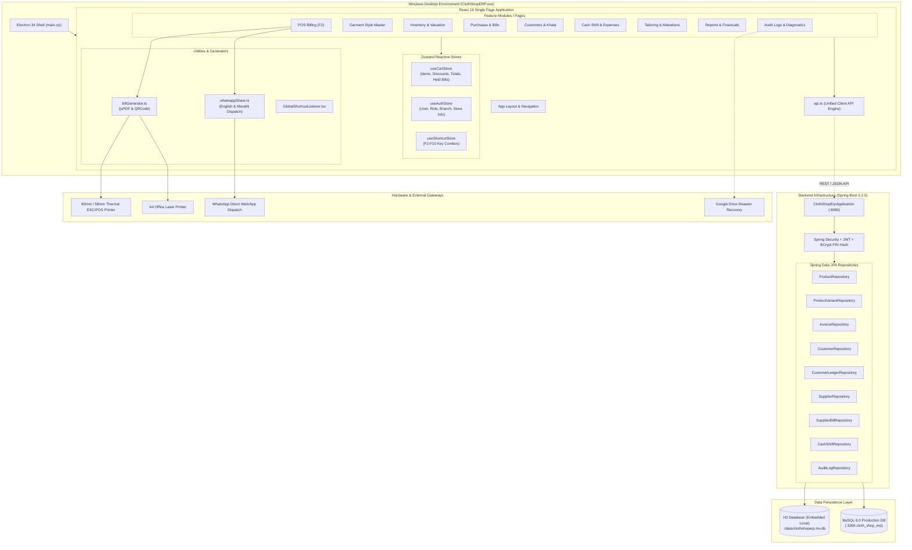
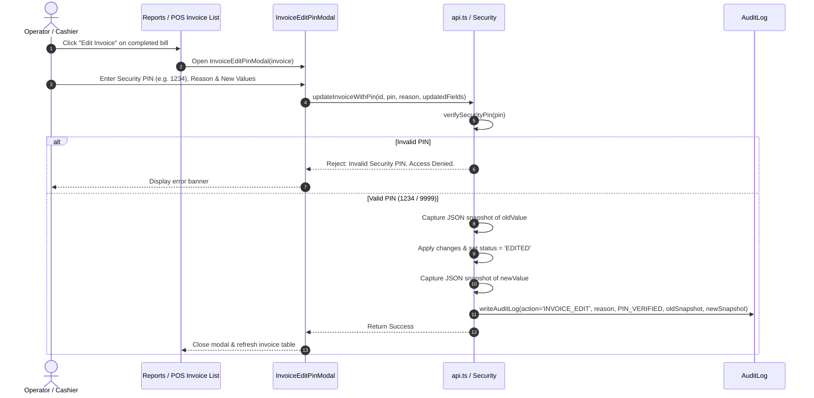

# System Documentation: Cloth Shop ERP & POS Desktop System
**Store Deployment:** Shravani Collection & New SK Telors (Pargaon / Mangrul)  
**System Version:** 1.0.0 Production  
**Document Classification:** Comprehensive Technical & Operational Architecture Specification  

---

## Table of Contents
1. [System Overview](#1-system-overview)
   - 1.1 High-Level Purpose & Problem Statement
   - 1.2 Target Store & Retail Context
   - 1.3 Technology Stack Summary
2. [System Architecture & Workflow](#2-system-architecture--workflow)
   - 2.1 Multi-Tier Architecture Diagram (Mermaid)
   - 2.2 End-to-End Data Flow & Module Interactions
   - 2.3 POS Billing & Checkout Lifecycle Diagram (Mermaid)
   - 2.4 Inward Purchase & Stock Movement Workflow Diagram (Mermaid)
   - 2.5 Security PIN Authorization & Audit Sequence Diagram (Mermaid)
3. [Core Features & Functionality](#3-core-features--functionality)
   - 3.1 Executive Business Dashboard
   - 3.2 High-Speed Keyboard-First POS Billing Engine
   - 3.3 Multi-Tender & Split Settlement Engine
   - 3.4 Dual-Mode Receipt Generation (80mm Thermal & A4 Tax Invoice)
   - 3.5 Dynamic Smartphone-Scannable QR Text Receipts
   - 3.6 Bi-Lingual WhatsApp Bill Sharing (English & Marathi)
   - 3.7 Garment Style Master & Size × Color Matrix Generator
   - 3.8 Barcode Label Designer & Thermal Tag Printing
   - 3.9 Real-Time Inventory, Valuation & Stock Movements
   - 3.10 Purchase Orders, Goods Received Notes (GRN) & Inward Bills
   - 3.11 Customer Khata (Credit Ledger) & Loyalty Points
   - 3.12 Supplier Ledgers & Accounts Payable
   - 3.13 Tailoring & Garment Alterations Lifecycle
   - 3.14 Cash Shift Reconciliation & Day-Closing Drawer Audit
   - 3.15 Store Expenses & Outflow Accounting
   - 3.16 Financial Analytics, Audit Reports & GST Filing
   - 3.17 Role-Based Access Control (RBAC) & Terminal Switching
   - 3.18 Disaster Recovery, Local Snapshots & Cloud Backup
   - 3.19 Configurable Keyboard Shortcuts & System Settings
   - 3.20 Security PIN Protected Invoice Modification & Immutable Audit Logs
   - 3.21 Dynamic Indian Apparel GST Slab Engine & Inter-State Tax Splitting
   - 3.22 Cut-Piece Fabric / Meter Billing Engine
   - 3.23 Garment Exchange & Store Credit Note Workflow (F4 Shortcut)
   - 3.24 Salesman Commission Tracking & Performance Analytics
   - 3.25 Stock Aging & Dead Stock Clearance Engine (60 / 90 / 180+ Days)
   - 3.26 Customer Birthday, Anniversary & Khata Reminder Widget
   - 3.27 Silent ESC/POS Direct Thermal Printing & Negative Stock Guardrails
4. [Folder & File Structure](#4-folder--file-structure)
   - 4.1 Project Directory Tree
   - 4.2 Detailed Component & File Catalog
5. [Database Schema & Data Models](#5-database-schema--data-models)
   - 5.1 Relational Database Tables (MySQL & H2)
   - 5.2 Entity Relationships & Field Specifications
   - 5.3 Frontend TypeScript Interfaces & Enums
6. [API Endpoints & Interface Specifications](#6-api-endpoints--interface-specifications)
   - 6.1 Spring Boot REST Controllers & Endpoints
   - 6.2 Electron Desktop IPC Channels (`preload.cjs`)
   - 6.3 Frontend Service API Layer (`api.ts`)
7. [Configuration & Setup Guide](#7-configuration--setup-guide)
   - 7.1 Prerequisites & System Requirements
   - 7.2 Frontend Installation & Desktop Execution
   - 7.3 Windows Executable Packaging (`.exe`)
   - 7.4 Backend Setup (H2 Embedded vs MySQL Production)
   - 7.5 Docker Containerized Deployment
   - 7.6 Environment Variables & Configuration Dictionary
8. [Error Handling, Security & Edge Cases](#8-error-handling-security--edge-cases)
   - 8.1 Authentication & Manager Authorization PIN
   - 8.2 Client Sandbox Security Architecture
   - 8.3 POS Billing Edge Cases & Failsafes
   - 8.4 Data Integrity, Khata Balance & Concurrency Guarantees

---

## 1. System Overview

### 1.1 High-Level Purpose & Problem Statement
Traditional clothing retail businesses and tailoring enterprises often struggle with fragmented management systems. Point-of-Sale (POS) software designed for standard supermarkets fails to handle garment-specific dimensions (size-color matrix, alteration jobs, fabric tracking, and seasonal styles). Conversely, pure accounting platforms lack the rapid, barcode-driven keyboard shortcuts required by cashiers handling heavy footfall.

**Cloth Shop ERP** is an integrated, enterprise-grade Desktop Enterprise Resource Planning (ERP) and Point of Sale (POS) solution custom-built for high-velocity clothing, textile, and tailoring retail shops. It provides:
- **Instant POS Counter Checkouts:** Full keyboard navigation without requiring mouse interaction, rapid barcode scanning, and multi-tender splits.
- **Garment Matrix Inventory:** Combinatorial SKU/barcode generation across sizes and colors, supporting thousands of stock items.
- **Custom Tailoring & Alteration Management:** Dedicated tracking of tailor measurements, due dates, charges, and customer pickup alerts.
- **Khata Credit Accounting:** Double-entry ledger for retail credit customers and textile suppliers with running balances.
- **Modern Receipting & Zero-Cost Messaging:** Dual thermal (80mm) and A4 PDF printing, combined with direct WhatsApp dispatch in English and Marathi without third-party API fees.
- **Tamper-Evident Security:** PIN-protected bill modification with complete snapshot audit trails.

### 1.2 Target Store & Retail Context
The system is configured for **Shravani Collection & New SK Telors**:
- **Store Location:** Pargaon (Mangrul), Maharashtra, India
- **Contact:** +91 8999308582
- **GSTIN:** 27AABCU9603R1ZM
- **Business Scope:** Men's formal & casual wear, denim, ethnic silk sarees (Yeola Paithani), children's apparel, suiting/shirting fabric, and custom tailoring services.

### 1.3 Technology Stack Summary

| Layer | Technologies Used | Purpose |
| :--- | :--- | :--- |
| **Desktop Shell** | **Electron 34**, `@electron/packager`, `electron-builder` | Standalone native Windows x64 desktop windowing, OS lifecycle, hardware printer interface |
| **Desktop Alternative** | **Tauri (Rust)** (`src-tauri/tauri.conf.json`) | Lightweight desktop bundle option with native OS hooks |
| **Frontend Framework** | **React 19**, **TypeScript 6.0**, **Vite 8.3** | High-performance reactive UI rendering and type safety |
| **Styling & Icons** | **Tailwind CSS 3.4**, **Lucide React 1.52** | Clean executive dashboard styling, responsive layouts, iconography |
| **State Management** | **Zustand 5.0** | Centralized, persistent reactive stores for cart, auth, and shortcuts |
| **Data Visualization** | **Recharts 3.10** | Monthly sales trends, category donut breakdown charts |
| **Document & QR Generation** | **jsPDF 4.2**, **qrcode 1.5** | Dynamic vector PDF invoice generation and high-density text QR codes |
| **Backend API (Optional/Full)** | **Java 17**, **Spring Boot 3.2.5** | Enterprise REST microservices, business validation, Flyway migrations |
| **Security Layer** | **Spring Security**, **JJWT 0.12.5**, BCrypt | Token authentication, encrypted PIN hashing, role authorization |
| **Database Engines** | **H2 Database (Embedded)** & **MySQL 8.0** | Zero-configuration file database `./data/clothshoperp` or production MySQL |
| **Packaging & CI** | **Windows Batch Scripts**, **Docker**, **Docker Compose** | One-click `.exe` packaging, process supervision, containerized cloud run |

---

## 2. System Architecture & Workflow

### 2.1 Multi-Tier Architecture Diagram
The system can operate in two primary deployment modes:
1. **Fully Standalone Desktop Mode (Zero-Friction):** Electron hosts the React SPA with an optimized local state engine and H2 database fallback. No cloud or network connection is required.
2. **Client-Server / Network Mode:** Electron client communicates over HTTP/REST with the Spring Boot backend service, persisting to MySQL 8.0 with automated background cloud synchronization.



### 2.2 End-to-End Data Flow & Module Interactions
1. **Product Inward & Cataloging:** Garments are entered either individually or via the **Size × Color Matrix Modal**. SKUs and barcodes are generated automatically. Inward Purchase Bills (GRN) increment the stock of variants and record payables in the **Supplier Ledger**.
2. **Counter Checkout (POS):**
   - The cashier scans barcodes or searches by article name (`F3`).
   - The `CartStore` verifies stock availability, applies item or bill discounts, and calculates GST taxes.
   - The cashier triggers checkout (`F5` for Cash, `F6` for UPI/Card, `F8` for Split).
   - In **Credit (Khata)** sales, customer credit limits and outstanding balances are verified.
3. **Transaction Settlement:**
   - The invoice record is created with a unique sequence number (e.g., `INV-2026-1050`).
   - Stock counts in `ProductVariant` are decremented.
   - If paid in cash, the `CashShift` drawer balance is updated.
   - If settled via Khata, a debit entry is written to `CustomerLedger`.
   - An immutable snapshot is appended to `AuditLog`.
4. **Receipting & Digital Dispatch:**
   - The **Bill Review Modal** opens automatically with preview options (A4 vs. Thermal).
   - A scannable text QR code is computed via `QRCode.toDataURL()`.
   - Cashiers can print thermal receipts, download a formatted PDF, or dispatch bill summaries to the customer's phone via WhatsApp in English or Marathi.

### 2.3 POS Billing & Checkout Lifecycle Diagram
```mermaid
sequenceDiagram
    autonumber
    actor Cashier
    participant UI as POSPage (React)
    participant Cart as CartStore (Zustand)
    participant Modal as PaymentModal
    participant API as api.ts / Backend
    participant Ledger as CustomerLedger
    participant Shift as CashShift
    participant Bill as BillReviewModal
    actor Customer

    Cashier->>UI: Scan barcode (e.g., 8900000001000) or press F3
    UI->>Cart: addItem(variant, qty=1)
    Cart-->>UI: Update active cart list & totals (Subtotal, GST, Net Total)

    alt Customer Wants to Hold Bill (F10)
        Cashier->>UI: Press F10 (Hold Bill)
        UI->>Cart: holdBill()
        Cart-->>UI: Bill parked in queue; cart cleared for next customer
    else Normal Checkout
        Cashier->>UI: Press F5 (Cash) or F6 (UPI) or F8 (Split)
        UI->>Modal: Open PaymentModal with tender mode
        Cashier->>Modal: Enter cash tendered / UPI ref / Khata selection
        Modal->>API: createInvoice(payload)
        
        API->>API: Deduct stock from ProductVariant
        
        opt Payment Mode is CASH
            API->>Shift: Increment cashSales & expectedCash
        end
        
        opt Payment Mode is CREDIT or SPLIT
            API->>Ledger: Insert SALE debit entry & update outstandingBalance
        end
        
        API->>API: Record AUDIT_LOG (INVOICE_GENERATED)
        API-->>Modal: Return verified Invoice entity
        Modal->>Cart: clearCart()
        Modal-->>UI: Close PaymentModal
        UI->>Bill: Open BillReviewModal(invoice)
        
        par Thermal Print
            Cashier->>Bill: Click Print Thermal (ESC/POS)
            Bill-->>Customer: Hand over 80mm paper slip
        and WhatsApp Share
            Cashier->>Bill: Click WhatsApp Marathi/English
            Bill->>Customer: Direct message with bill summary & Khata due
        end
    end
```

### 2.4 Inward Purchase & Stock Movement Workflow Diagram

```mermaid
flowchart TD
    Start([Receive Garment Shipment from Supplier]) --> CheckPO{Linked to Purchase Order?}
    
    CheckPO -- Yes --> FetchPO[Load Purchase Order details & quantities]
    CheckPO -- No --> NewBill[Create Inward Bill directly with GRN]
    
    FetchPO --> Inspect[Physical verification of sizes, colors & fabrics]
    NewBill --> Inspect
    
    Inspect --> Form[Fill Supplier Bill Modal: Invoice No, Date, Tax, Due Date]
    Form --> AddItems[Add Variant Rows: Received Qty, Cost Price, Selling Price]
    
    AddItems --> Submit[Submit Inward Purchase Bill]
    
    Submit --> UpdateStock[Increment variant.stock for each SKU]
    Submit --> UpdatePrices[Update variant.costPrice & variant.sellingPrice]
    Submit --> CreateBillRecord[Create SupplierBill entity]
    Submit --> UpdateLedger[Add PURCHASE_CREDIT in SupplierLedger]
    Submit --> UpdateSupplierBalance[Increment supplier.outstandingPayable]
    
    CheckPO -- If PO Linked --> MarkPO[Update PurchaseOrder status = RECEIVED]
    
    UpdateSupplierBalance --> AuditLog[Write PURCHASE_BILL_CREATED to AuditLog]
    AuditLog --> Complete([Inventory & Ledgers Synchronized])
```


### 2.5 Security PIN Authorization & Audit Sequence Diagram


---

## 3. Core Features & Functionality

### 3.1 Executive Business Dashboard
- **What It Does:** Serves as the central executive cockpit displaying retail performance metrics, revenue growth, profit margin breakdowns, customer acquisition metrics, and garment category sales.
- **Under the Hood:**
  - Aggregates live transaction counts, customer Khata balances, and inventory valuation via `api.getDashboardMetrics()`.
  - Renders monthly revenue trends using `recharts` `<BarChart>` and sales distributions using `<PieChart>` donut charts.
  - Generates immediate client-side CSV downloads formatted for quarterly business reporting (`Executive_Summary_Report.csv`).
- **Relevant Files:**
  - `frontend/src/pages/dashboard/DashboardPage.tsx`
  - `frontend/src/services/api.ts` (`getDashboardMetrics`)
- **Inputs & Outputs:**
  - *Inputs:* Filter ranges, live sales aggregates.
  - *Outputs:* 4 Executive KPI cards (Revenue ₹24.5M, Active Customers, Net Margin 38%, Low Return Rate), interactive charts, and CSV report export.

### 3.2 High-Speed Keyboard-First POS Billing Engine
- **What It Does:** Enables cashiers to complete high-volume billing operations without using a mouse. Supports instant barcode scanner inputs, search-as-you-type, automated focus management, item-level discounts, and cart parking.
- **Under the Hood:**
  - Managed by `useCartStore` (Zustand). Barcode scans match against `variant.barcode` or `variant.sku`.
  - Arrow-key navigation (`↑` / `↓`) traverses the product search result list; pressing `Enter` adds the item to the cart.
  - `GlobalShortcutListener.tsx` intercepts global key events (`F2` for New Sale, `F3` for Search, `F5` for Cash, `F6` for UPI, `F8` for Split, `F10` for Hold Bill, `Escape` to Clear).
  - Bill discount logic dynamically recalculates when cashiers edit the final bill amount directly.
- **Relevant Files:**
  - `frontend/src/pages/pos/POSPage.tsx`
  - `frontend/src/stores/cartStore.ts`
  - `frontend/src/components/common/GlobalShortcutListener.tsx`
- **Inputs & Outputs:**
  - *Inputs:* Barcode scanner keystrokes, item search queries, quantity modifiers, customer phone/name.
  - *Outputs:* Active itemized cart, real-time totals (Subtotal, GST, Net Total), and held bill queue.

### 3.3 Multi-Tender & Split Settlement Engine
- **What It Does:** Supports full cash payments, UPI digital payments, cards, cheques, bank transfers, Khata credit, and complex split payments across multiple payment modes for a single invoice.
- **Under the Hood:**
  - Implemented in `PaymentModal.tsx`.
  - For Cash: computes change returnable (`cashTendered - grandTotal`).
  - For Split: validates that the sum of all tenders equals `grandTotal` exactly.
  - For Credit (Khata): enforces customer selection and verifies that `outstandingBalance + billTotal <= creditLimit`.
- **Relevant Files:**
  - `frontend/src/components/pos/PaymentModal.tsx`
  - `frontend/src/services/api.ts` (`createInvoice`)
- **Inputs & Outputs:**
  - *Inputs:* Selected payment mode, tendered cash, UPI reference string, customer profile.
  - *Outputs:* Validated `Invoice` object with `splitDetails`, ledger posting, and cash drawer adjustment.

### 3.4 Dual-Mode Receipt Generation (80mm Thermal & A4 Tax Invoice)
- **What It Does:** Generates professional print output in two standard formats: standard 80mm ESC/POS thermal counter slips and formal A4 Tax Invoices formatted with store credentials.
- **Under the Hood:**
  - `billGenerator.ts` utilizes `jspdf` to create vector-perfect A4 documents with company header, itemized tables, GST rate breakdown, and authorized signature blocks.
  - Thermal view (`ThermalReceipt.tsx`) formats CSS `@media print` rules specifically for continuous thermal paper rolls (80mm / 3-inch roll).
  - Cashier vs. Manager role stamp: Bills dynamically stamp whether the receipt was generated by an authorized `Manager Print Bill` or `Cashier Print Bill`.
- **Relevant Files:**
  - `frontend/src/utils/billGenerator.ts`
  - `frontend/src/components/pos/BillReviewModal.tsx`
  - `frontend/src/components/pos/ThermalReceipt.tsx`
- **Inputs & Outputs:**
  - *Inputs:* Completed `Invoice`, `store` configuration, logged-in operator role.
  - *Outputs:* Direct system print dialog, downloadable `.pdf` file.

### 3.5 Dynamic Smartphone-Scannable QR Text Receipts
- **What It Does:** Renders a clean, high-density QR code on receipts. When scanned by any smartphone camera (Google Lens, iOS Camera, Samsung, Vivo, Oppo), it immediately displays the full itemized digital bill and store information as plain readable text without requiring an internet connection or app installation.
- **Under the Hood:**
  - `getInvoiceQrText()` formats an ASCII bill string containing store details, invoice number, line items, and totals.
  - `generateInvoiceQrDataUrl()` compiles this text via `qrcode` with Error Correction Level `L` for optimal camera scanning speed.
- **Relevant Files:**
  - `frontend/src/utils/billGenerator.ts` (`getInvoiceQrText`, `generateInvoiceQrDataUrl`)
  - `frontend/src/components/pos/BillReviewModal.tsx`

### 3.6 Bi-Lingual WhatsApp Bill Sharing (English & Marathi)
- **What It Does:** Sends complete, beautifully formatted purchase receipts directly to the customer's WhatsApp in their preferred language (English or Marathi) with zero API costs.
- **Under the Hood:**
  - `formatWhatsAppPhone()` cleans phone numbers, sanitizes symbols, and prepends India's `91` country code.
  - Generates localized message templates (`getEnglishWhatsAppMessage` and `getMarathiWhatsAppMessage`) containing invoice numbers, itemized lists, discounts, net totals, and customer Khata balance due.
  - Dispatches messages via browser window invocation using `https://wa.me/91XXXXXXXXXX?text=...`.
- **Relevant Files:**
  - `frontend/src/utils/whatsappShare.ts`
  - `frontend/src/components/pos/BillReviewModal.tsx`
  - `frontend/src/pages/communications/CommunicationsPage.tsx`

### 3.7 Garment Style Master & Size × Color Matrix Generator
- **What It Does:** Eliminates manual data entry for clothing variants by generating parent styles and combinatorial size-color variant matrices in seconds.
- **Under the Hood:**
  - In `SizeColorMatrixModal.tsx`, users define parent style attributes (article name, brand, category, HSN, fabric, care instructions) and select multiple colors (e.g., Pure White, Navy Blue, Wine Maroon) and sizes (e.g., 38, 40, 42, 44).
  - Computes the Cartesian product $(Colors \times Sizes)$, generating SKUs (e.g., `RAY-CLA-PUR-38S`) and barcodes (EAN-style `890...`).
  - Supports bulk pricing application (Cost Price, MRP, Selling Price, Initial Stock) across all generated variants simultaneously.
- **Relevant Files:**
  - `frontend/src/pages/products/ProductsPage.tsx`
  - `frontend/src/components/matrix/SizeColorMatrixModal.tsx`
  - `backend/src/main/java/com/clothshop/erp/model/Product.java`
  - `backend/src/main/java/com/clothshop/erp/model/ProductVariant.java`

### 3.8 Barcode Label Designer & Thermal Tag Printing
- **What It Does:** Formats and prints thermal garment hangtags and sticker barcode labels (standard 50mm × 25mm and 38mm × 25mm formats).
- **Under the Hood:**
  - `BarcodeLabelModal.tsx` allows selection of specific SKUs and configuration of copy counts per variant.
  - Provides toggles for store branding, article names, sizes, colors, MRP, discount percentage, and barcodes.
  - Renders print-ready CSS grids optimized for thermal barcode printers (TVS, TSC, Zebra, Citizen).
- **Relevant Files:**
  - `frontend/src/components/matrix/BarcodeLabelModal.tsx`
  - `frontend/src/pages/products/ProductsPage.tsx`

### 3.9 Real-Time Inventory, Valuation & Stock Movements
- **What It Does:** Tracks stock across all variants, provides low-stock reorder warnings, supports manual stock count adjustments with audit reasons, and enables inter-branch transfers.
- **Under the Hood:**
  - Real-time stock counts are decremented on POS checkout and incremented on purchase bills or inward returns.
  - Adjustments record entries in `inventory_movements` with `movementType` (`ADJUSTMENT_ADD`, `ADJUSTMENT_REMOVE`, `TRANSFER_OUT`, `TRANSFER_IN`).
  - Displays total inventory valuation based on current selling prices and costs.
- **Relevant Files:**
  - `frontend/src/pages/inventory/InventoryPage.tsx`
  - `backend/src/main/java/com/clothshop/erp/model/InventoryMovement.java`
  - `backend/src/main/java/com/clothshop/erp/repository/InventoryMovementRepository.java`

### 3.10 Purchase Orders, Goods Received Notes (GRN) & Inward Bills
- **What It Does:** Complete supplier procurement lifecycle from Purchase Order (PO) drafting to physical shipment inward (GRN / Supplier Purchase Bill).
- **Under the Hood:**
  - When inward purchase bills are confirmed in `createSupplierBillWithItems`:
    1. Inventory stock is automatically incremented.
    2. Cost prices and selling prices are updated across matching variants.
    3. The linked PO status is marked as `RECEIVED`.
    4. A `PURCHASE_CREDIT` transaction is recorded in the `SupplierLedger`, updating `supplier.outstandingPayable`.
- **Relevant Files:**
  - `frontend/src/pages/inventory/InventoryPage.tsx` (PO & Inward Bills tabs)
  - `frontend/src/pages/purchases/PurchasesPage.tsx`
  - `backend/src/main/java/com/clothshop/erp/model/SupplierBill.java`

### 3.11 Customer Khata (Credit Ledger) & Loyalty Points
- **What It Does:** Traditional Indian retail Khata (credit ledger) system. Maintains customer balances, credit limits, transaction histories, loyalty points, and payment receipts.
- **Under the Hood:**
  - `CustomerLedgerEntry` logs every financial transaction (`SALE`, `PAYMENT_RECEIVED`, `PAYMENT_GIVEN`, `RETURN`, `ADVANCE`, `REFUND`).
  - Khata view filters transactions by Credit purchases, Cash purchases, or all combined.
  - Automatically accrues loyalty points (1 point per ₹100 spent) upon checkout.
- **Relevant Files:**
  - `frontend/src/pages/customers/CustomersPage.tsx`
  - `backend/src/main/java/com/clothshop/erp/model/Customer.java`
  - `backend/src/main/java/com/clothshop/erp/model/CustomerLedger.java`

### 3.12 Supplier Ledgers & Accounts Payable
- **What It Does:** Tracks trade credit and payments for textile mills, wholesale saree hubs, and fabric distributors.
- **Under the Hood:**
  - Records purchase bills as credits (increasing payable) and payments (cash/UPI/RTGS/Cheque) as debits (decreasing payable).
  - Maintains a continuous running balance and supports invoice linking and document attachment URLs.
- **Relevant Files:**
  - `frontend/src/pages/purchases/PurchasesPage.tsx`
  - `backend/src/main/java/com/clothshop/erp/model/Supplier.java`
  - `backend/src/main/java/com/clothshop/erp/model/SupplierLedger.java`

### 3.13 Tailoring & Garment Alterations Lifecycle
- **What It Does:** Manages custom tailoring services, garment alterations, measurements, tailor assignments, due dates, and customer pickup alerts.
- **Under the Hood:**
  - Records garment type, customer contact, measurements (Length, Waist, Chest, Inseam), tailor assignment (e.g., Master Rafiq), and alteration fee.
  - Status progression: `PENDING` $\rightarrow$ `ASSIGNED` $\rightarrow$ `IN_PROGRESS` $\rightarrow$ `READY` $\rightarrow$ `DELIVERED`.
  - One-click WhatsApp notification to inform customers when garments are ready for pickup.
- **Relevant Files:**
  - `frontend/src/pages/alterations/AlterationsPage.tsx`
  - `backend/src/main/java/com/clothshop/erp/model/Alteration.java`

### 3.14 Cash Shift Reconciliation & Day-Closing Drawer Audit
- **What It Does:** Balances the physical cash drawer at the start and end of every cashier shift to detect shortages or excess cash.
- **Under the Hood:**
  - Records `openingCash` float.
  - Automatically aggregates cash sales from invoices and deducts cash store expenses.
  - Formula: $\text{Expected Cash} = \text{Opening} + \text{Cash Sales} + \text{Cash In} - \text{Refunds} - \text{Cash Expenses}$.
  - Computes $\text{Difference} = \text{Actual Cash} - \text{Expected Cash}$ and logs closing notes.
- **Relevant Files:**
  - `frontend/src/pages/accounting/AccountingPage.tsx`
  - `backend/src/main/java/com/clothshop/erp/model/CashShift.java`

### 3.15 Store Expenses & Outflow Accounting
- **What It Does:** Records miscellaneous operational store expenses (packaging carry bags, electricity bills, tempo freight transport, staff tea, maintenance).
- **Under the Hood:**
  - If paid via `CASH`, automatically deducts the amount from the active cash shift drawer.
  - Categorizes expenses and links creator audit identity.
- **Relevant Files:**
  - `frontend/src/pages/accounting/AccountingPage.tsx`
  - `backend/src/main/java/com/clothshop/erp/model/Expense.java`

### 3.16 Financial Analytics, Audit Reports & GST Filing
- **What It Does:** Generates audit-ready sales summaries, GST tax liability reports (CGST 2.5%, SGST 2.5%, HSN 6205/6203), inventory valuation, and invoice reprint catalogs.
- **Under the Hood:**
  - Offers date filtering and table sorting.
  - One-click CSV export formatted for Chartered Accountant (CA) filing.
  - Direct invoice reprint and preview from historical records.
- **Relevant Files:**
  - `frontend/src/pages/reports/ReportsPage.tsx`

### 3.17 Role-Based Access Control (RBAC) & Terminal Switching
- **What It Does:** Enforces security permissions across staff roles (`OWNER`, `MANAGER`, `CASHIER`, `ACCOUNTANT`, `TAILOR`, `INVENTORY_MANAGER`). Enables instant cashier user switching on the active POS counter without application restart, fast 1-click staff logins, interactive role permission customization, and strict UI sidebar / route guards.
- **Under the Hood:**
  - Managed by `useAuthStore` (Zustand) with dynamic hydration and custom role overrides persisted in `localStorage` (`cloth_shop_erp_role_permissions`).
  - **Staff Terminal Sign-In (`LoginPage.tsx`):** Provides 1-click Fast Tap sign-in for counter staff and standard username/PIN login with offline standalone desktop fallback.
  - **Fast Terminal Switching (`AppLayout.tsx`):** Arrow-key and mouse accessible switcher modal allows cashiers to switch active accounts in seconds, immediately logging a `TERMINAL_SWITCH` event in `audit_logs` and redirecting unauthorized routes to permitted workspaces.
  - **Interactive Granular RBAC Matrix (`EmployeesPage.tsx`):** Displays and toggles real-time permissions across all 6 roles and 18 system modules, with factory reset capability.
  - **Sidebar & Route Guards (`App.tsx`, `AppLayout.tsx`):** Sidebar navigation dynamically hides unauthorized modules; URL/tab routing renders an access-restricted barrier if an unauthorized user attempts to open a protected tab.
  - **Global Shortcut Guardrails (`GlobalShortcutListener.tsx`):** Suppresses POS hotkeys when logged out or when modal dialogs are open, and denies sales shortcuts to unauthorized roles (e.g., Tailor, Accountant).
- **Relevant Files:**
  - `frontend/src/pages/auth/LoginPage.tsx`
  - `frontend/src/stores/authStore.ts`
  - `frontend/src/pages/employees/EmployeesPage.tsx`
  - `frontend/src/components/layout/AppLayout.tsx`
  - `frontend/src/App.tsx`
  - `frontend/src/components/common/GlobalShortcutListener.tsx`
  - `backend/src/main/java/com/clothshop/erp/controller/AuthController.java`
  - `backend/src/main/java/com/clothshop/erp/config/SecurityConfig.java`

### 3.18 Disaster Recovery, Local Snapshots & Cloud Backup
- **What It Does:** Creates full database snapshots with verification, supports Google Drive cloud folder synchronization, and provides disaster recovery rollback.
- **Under the Hood:**
  - Local database dumps (`.sql` / `.mv.db`) are saved with timestamps.
  - Google Drive upload daemon mirrors verified archives to cloud folders.
  - Automated pre-restore validation protects against corrupted backup states.
- **Relevant Files:**
  - `frontend/src/pages/backup/BackupPage.tsx`
  - `backend/src/main/resources/application.yml` (`app.backup`)

### 3.19 Configurable Keyboard Shortcuts & System Settings
- **What It Does:** Customizes store details (branch name, address, GSTIN, phone), default GST tax rates, inventory policies (`blockNegativeStock`), thermal printer hardware, and interactive keyboard shortcuts (F2 through F10).
- **Under the Hood:**
  - `useShortcutStore` provides live key capture: cashiers can select an action (e.g., Cash Payment) and press any key combination (e.g., `F5`) to re-bind it.
  - Settings persist in `SystemSetting` models and localStorage `cloth_shop_erp_settings`.
- **Relevant Files:**
  - `frontend/src/pages/settings/SettingsPage.tsx`
  - `frontend/src/stores/shortcutStore.ts`
  - `backend/src/main/java/com/clothshop/erp/model/SystemSetting.java`

### 3.20 Security PIN Protected Invoice Modification & Immutable Audit Logs
- **What It Does:** Prevents unauthorized cashier tampering with completed sales. Any modification to customer details, discounts, or bill totals requires an authorized Security PIN (`1234` / `9999`) and a mandatory business justification reason.
- **Under the Hood:**
  - `InvoiceEditPinModal.tsx` intercepts modification requests and verifies the PIN via backend `/api/admin/verify-pin` or Electron IPC `verify-pin`. Hardcoded client-side checks are completely removed.
  - If authorized, creates a before-and-after JSON snapshot diff and marks the invoice status as `EDITED`.
  - Records an immutable event in the `audit_logs` table with username, role, timestamp, reason, and auth method.
- **Relevant Files:**
  - `frontend/src/components/invoice/InvoiceEditPinModal.tsx`
  - `frontend/src/pages/admin/AdminPage.tsx`
  - `backend/src/main/java/com/clothshop/erp/controller/AdminController.java`
  - `backend/src/main/java/com/clothshop/erp/model/AuditLog.java`

### 3.21 Dynamic Indian Apparel GST Slab Engine & Inter-State Tax Splitting
- **What It Does:** Automatically enforces statutory Indian garment GST price-threshold rules:
  - Garments priced strictly below ₹1,000 per piece attract **5% GST**.
  - Garments priced ₹1,000 and above per piece attract **12% GST**.
  - Custom HSN-level tax overrides (e.g., silk sarees, cotton woven, denim trousers).
  - Intra-state sales (within Maharashtra, State Code `27`) automatically split the tax into equal **CGST (2.5% / 6%)** and **SGST (2.5% / 6%)**.
  - Inter-state sales (out-of-state customer GSTIN) apply full **IGST (5% / 12%)**.
- **Under the Hood:**
  - Implemented dynamically inside `cartStore.ts`, `api.ts`, and `billGenerator.ts`.
  - Every line item's net unit price is evaluated against the ₹1,000 threshold to select the statutory tax bracket.
- **Relevant Files:**
  - `frontend/src/stores/cartStore.ts`
  - `frontend/src/services/api.ts`
  - `frontend/src/utils/billGenerator.ts`

### 3.22 Cut-Piece Fabric / Meter Billing Engine
- **What It Does:** Enables seamless retail sales of unstitched suiting and shirting fabrics alongside standard readymade garments.
- **Under the Hood:**
  - `ProductVariant`, `CartItem`, and `InvoiceItem` support `unitType` (`PCS` vs. `METER`).
  - Readymade garments enforce integer piece quantities (`1`, `2`, `3`).
  - Meter fabrics allow fractional decimal lengths (e.g., `1.25`, `2.40`, `3.50` meters) with `0.25m` stepping and direct decimal input.
  - Thermal receipts and WhatsApp messages format units accurately as `1.25 Mtr` / `१.२५ मीटर`.
- **Relevant Files:**
  - `frontend/src/types/index.ts`
  - `frontend/src/pages/pos/POSPage.tsx`
  - `frontend/src/stores/cartStore.ts`
  - `frontend/src/utils/billGenerator.ts`
  - `frontend/src/utils/whatsappShare.ts`

### 3.23 Garment Exchange & Store Credit Note Workflow (F4 Shortcut)
- **What It Does:** Dedicated high-speed exchange and return workflow triggered instantly via `F4`:
  - Cashier enters or scans past invoice number or customer mobile number.
  - Lists sold garments with original prices and sizes.
  - Cashier selects items for return with reason code (e.g., "Size Mismatch", "Fabric Defect").
  - Returned items are added to current cart with `isReturn: true` and automatically increment inventory stock upon checkout.
  - If return value exceeds new purchase, the difference is converted into a redeemable **Store Credit Note / Voucher** (valid for 90 days).
  - Cashiers can redeem credit note vouchers directly at checkout to offset new purchases.
- **Relevant Files:**
  - `frontend/src/pages/pos/POSPage.tsx`
  - `frontend/src/stores/cartStore.ts`
  - `frontend/src/services/api.ts`
  - `backend/src/main/java/com/clothshop/erp/controller/InvoiceController.java`

### 3.24 Salesman Commission Tracking & Performance Analytics
- **What It Does:** Incentivizes store sales staff through automated commission accounting.
- **Under the Hood:**
  - POS cashier assigns a salesman (`salesmanName` / `salesmanId`) per transaction.
  - System automatically calculates a 2.0% store incentive commission on completed sales.
  - Dedicated **Salesman Commission Summary** tab inside `ReportsPage.tsx` provides gross sales, invoice counts, average basket size, and approved commission payouts with CSV export for payroll.
- **Relevant Files:**
  - `frontend/src/pages/pos/POSPage.tsx`
  - `frontend/src/pages/reports/ReportsPage.tsx`
  - `frontend/src/services/api.ts`
  - `backend/src/main/java/com/clothshop/erp/model/Invoice.java`

### 3.25 Stock Aging & Dead Stock Clearance Engine (60 / 90 / 180+ Days)
- **What It Does:** Identifies slow-moving and dead inventory to assist the owner in planning clearance sales, festival discounts, or vendor returns.
- **Under the Hood:**
  - Computes unsold duration (`daysUnsold`) based on the most recent sale (`lastSoldAt`) or inward receipt (`lastReceivedAt`).
  - Interactive views inside `InventoryPage.tsx` and `ReportsPage.tsx` categorized by:
    - **60+ Days Unsold:** Moderate slow-moving stock.
    - **90+ Days Unsold:** Aged inventory needing discount promotions.
    - **180+ Days (Dead Stock):** Critical clearance candidates with tied working capital analytics.
  - One-click markdown and stock adjustment triggers.
- **Relevant Files:**
  - `frontend/src/pages/inventory/InventoryPage.tsx`
  - `frontend/src/pages/reports/ReportsPage.tsx`
  - `frontend/src/services/api.ts`
  - `backend/src/main/java/com/clothshop/erp/repository/ProductVariantRepository.java`

### 3.26 Customer Birthday, Anniversary & Khata Reminder Widget
- **What It Does:** Actionable customer relationship widget on `DashboardPage.tsx` promoting repeat footfall and rapid credit recovery.
- **Under the Hood:**
  - Evaluates registered customer birthdays and wedding anniversaries against the current calendar date.
  - Lists customers with overdue Khata credit balances.
  - One-click bilingual WhatsApp buttons (English & मराठी) dispatch personalized greetings with promotional discount invitations or friendly payment reminders.
- **Relevant Files:**
  - `frontend/src/pages/dashboard/DashboardPage.tsx`
  - `frontend/src/utils/whatsappShare.ts`
  - `frontend/src/services/api.ts`
  - `backend/src/main/java/com/clothshop/erp/controller/CustomerController.java`

### 3.27 Silent ESC/POS Direct Thermal Printing & Negative Stock Guardrails
- **What It Does:** Hardens retail counter operations against printing delays and inventory discrepancies.
- **Under the Hood:**
  - **Silent Thermal Printing:** Electron desktop shell uses `frontend/electron/preload.cjs` context bridge to dispatch receipts silently to 80mm ESC/POS printers (`webContents.print({ silent: true })`), bypassing the OS print dialog with automatic fallback to standard print preview.
  - **Stock Guardrail (`blockNegativeStock`):** Configurable system policy in `SettingsPage.tsx` that blocks cashiers from adding out-of-stock items or checking out with negative inventory quantities.
- **Relevant Files:**
  - `frontend/electron/main.cjs`
  - `frontend/electron/preload.cjs`
  - `frontend/src/components/pos/ThermalReceipt.tsx`
  - `frontend/src/components/pos/BillReviewModal.tsx`
  - `frontend/src/pages/settings/SettingsPage.tsx`
  - `frontend/src/stores/cartStore.ts`

---

## 4. Folder & File Structure

### 4.1 Project Directory Tree
```
d:\ERP SYSTEM
│
├── Build_Windows_EXE.bat                           # 1-Click Windows Production .EXE Compiler
├── Launch_Desktop_App.bat                          # Desktop Launcher (Electron Dev Shell)
├── Cloth_Shop_ERP_Desktop_Master_Specification 01.md # Master System Specification
├── SYSTEM_DOCUMENTATION.md                         # Comprehensive System Architecture (This File)
│
├── backend                                         # Java Spring Boot 3.2.5 REST Backend Service
│   ├── pom.xml                                     # Maven Dependencies & Build Configuration
│   └── src
│       └── main
│           ├── java
│           │   └── com
│           │       └── clothshop
│           │           └── erp
│           │               ├── ClothShopErpApplication.java  # Spring Boot Main Entry Point
│           │               ├── controller          # Spring Boot Enterprise REST API Endpoints
│           │               │   ├── AdminController.java
│           │               │   ├── AlterationController.java
│           │               │   ├── CustomerController.java
│           │               │   ├── ExpenseController.java
│           │               │   ├── InvoiceController.java
│           │               │   ├── ProductController.java
│           │               │   ├── ShiftController.java
│           │               │   └── SupplierController.java
│           │               ├── model               # JPA Domain Entity Models
│           │               │   ├── Alteration.java
│           │               │   ├── AuditLog.java
│           │               │   ├── CashShift.java
│           │               │   ├── Customer.java
│           │               │   ├── CustomerLedger.java
│           │               │   ├── Expense.java
│           │               │   ├── InventoryMovement.java
│           │               │   ├── Invoice.java
│           │               │   ├── InvoiceItem.java
│           │               │   ├── Product.java
│           │               │   ├── ProductVariant.java
│           │               │   ├── Supplier.java
│           │               │   ├── SupplierBill.java
│           │               │   ├── SupplierLedger.java
│           │               │   ├── SystemSetting.java
│           │               │   └── User.java
│           │               └── repository          # Spring Data JPA Data Repositories
│           │                   ├── AlterationRepository.java
│           │                   ├── AuditLogRepository.java
│           │                   ├── CashShiftRepository.java
│           │                   ├── CustomerLedgerRepository.java
│           │                   ├── CustomerRepository.java
│           │                   ├── ExpenseRepository.java
│           │                   ├── InventoryMovementRepository.java
│           │                   ├── InvoiceItemRepository.java
│           │                   ├── InvoiceRepository.java
│           │                   ├── ProductRepository.java
│           │                   ├── ProductVariantRepository.java
│           │                   ├── SupplierBillRepository.java
│           │                   ├── SupplierLedgerRepository.java
│           │                   ├── SupplierRepository.java
│           │                   ├── SystemSettingRepository.java
│           │                   └── UserRepository.java
│           └── resources
│               └── application.yml                 # Spring Boot Multi-Profile Config (H2 / MySQL)
│
├── docker                                          # Containerization & Cloud Deployment
│   ├── docker-compose.yml                          # MySQL 8.0 & Spring Boot Microservices
│   └── Dockerfile.backend                          # Multi-stage Maven + Eclipse Temurin 17 Image
│
├── frontend                                        # React 19 + TypeScript + Electron Client
│   ├── package.json                                # NPM Dependencies, Scripts & Electron Builder
│   ├── vite.config.ts                              # Vite Bundler Configuration
│   ├── tailwind.config.js                          # Tailwind CSS Palette & Typography Rules
│   ├── postcss.config.js                           # PostCSS Configuration
│   ├── tsconfig.json                               # TypeScript Project Configuration
│   ├── index.html                                  # Root HTML5 Shell
│   │
│   ├── electron                                    # Electron Desktop Framework
│   │   ├── main.cjs                                # Electron Main Process, BrowserWindow, Silent ESC/POS Printing
│   │   └── preload.cjs                             # ContextBridge Secure IPC API (Printing, PIN Verification)
│   │
│   ├── src-tauri                                   # Tauri Desktop Shell Config
│   │   └── tauri.conf.json                         # Tauri Native Window & File System Allowlist
│   │
│   └── src
│       ├── vite-env.d.ts                           # Global ElectronAPI Window Declarations
│       ├── main.tsx                                # React DOM Entry Point
│       ├── App.tsx                                 # Master Router & Navigation Tab Switcher
│       ├── index.css                               # Global Tailwind Directives & CSS Reset
│       │
│       ├── types                                   # TypeScript Shared Interfaces & Enums
│       │   └── index.ts                            # Products, Invoices, Khata, Ledger, Users
│       │
│       ├── stores                                  # Zustand Global Reactive Stores
│       │   ├── authStore.ts                        # Active User, Roles, Branch Identity
│       │   ├── cartStore.ts                        # Active POS Cart, Held Bills, Discounts
│       │   └── shortcutStore.ts                    # F2-F10 Configurable Keyboard Shortcuts
│       │
│       ├── services                                # Business Logic & Data Engine
│       │   ├── api.ts                              # Transactional In-Memory/REST API Engine
│       │   ├── inventoryData.ts                    # 1,000+ Preloaded Garment Articles & Variants
│       │   └── generate1000Inventory.js            # Synthetic Inventory Generator Script
│       │
│       ├── utils                                   # Helper Utilities
│       │   ├── billGenerator.ts                    # jsPDF Vector Invoicing & Text QR Code Engine
│       │   └── whatsappShare.ts                    # Bi-Lingual (EN/MR) WhatsApp Dispatcher
│       │
│       ├── components                              # Reusable Modular UI Components
│       │   ├── common
│       │   │   └── GlobalShortcutListener.tsx      # Global Keyboard Interceptor
│       │   ├── layout
│       │   │   └── AppLayout.tsx                   # Executive Sidebar, User Switcher & Header
│       │   ├── pos
│       │   │   ├── PaymentModal.tsx                # Cash, UPI, Split & Khata Tender Modal
│       │   │   ├── BillReviewModal.tsx             # Interactive Bill Review (PDF, QR, WhatsApp)
│       │   │   └── ThermalReceipt.tsx              # 80mm ESC/POS Thermal Print Preview
│       │   ├── matrix
│       │   │   ├── SizeColorMatrixModal.tsx        # Combinatorial Variant Matrix Generator
│       │   │   └── BarcodeLabelModal.tsx           # Thermal Tag & Sticker Label Designer
│       │   └── invoice
│       │       └── InvoiceEditPinModal.tsx         # Security PIN Protected Bill Modifier
│       │
│       └── pages                                   # Application Views
│           ├── dashboard/DashboardPage.tsx         # Executive KPI Cockpit & Revenue Charts
│           ├── pos/POSPage.tsx                     # Fast Barcode Scanner Keyboard Counter
│           ├── products/ProductsPage.tsx           # Garment Style Master & Matrix Viewer
│           ├── inventory/InventoryPage.tsx         # Inventory Valuation, Stock Adjustments, PO/GRN
│           ├── purchases/PurchasesPage.tsx         # Supplier Ledger & Purchase Credit Inwards
│           ├── customers/CustomersPage.tsx         # Customer Profiles & Khata Credit Ledger
│           ├── accounting/AccountingPage.tsx       # Cash Shift Reconciliation & Day Closing
│           ├── alterations/AlterationsPage.tsx     # Custom Tailoring & Measurement Jobs
│           ├── communications/CommunicationsPage.tsx# WhatsApp Broadcast & Alert Center
│           ├── reports/ReportsPage.tsx             # Financial Analytics, Sales Audit & GST Returns
│           ├── employees/EmployeesPage.tsx         # Staff Credentials & Role Permission Matrix
│           ├── backup/BackupPage.tsx               # Local Database Dumps & Google Drive Sync
│           ├── settings/SettingsPage.tsx           # System Defaults, Store Info & Shortcut Remap
│           └── admin/AdminPage.tsx                 # Immutable Audit Log Ledger & Diagnostics
│
└── scripts                                         # Windows Administrative Shell Scripts
    ├── start-erp.bat                               # Start Development Server
    ├── stop-erp.bat                                # Terminate Running ERP Node Processes
    └── restart-erp.bat                             # Clean Restart ERP Service
```

### 4.2 Detailed Component & File Catalog

| Path | Primary Responsibility |
| :--- | :--- |
| `Build_Windows_EXE.bat` | Production build automation script: executes `npm run build` and packages `ClothShopERP.exe` standalone folder via `@electron/packager`. |
| `Launch_Desktop_App.bat` | Launches the Electron desktop wrapper in development mode against the Vite frontend. |
| `frontend/electron/main.cjs` | Configures the Electron window (1366x768, hidden menu bar, zero-border POS styling) with hardened sandbox security (`nodeIntegration: false`, `contextIsolation: true`). |
| `frontend/src/stores/cartStore.ts` | Complete POS shopping cart state machine: item quantities, price recalculation, item discounts, bill-level discounts, and the `heldBills` queue. |
| `frontend/src/stores/authStore.ts` | Session management: active logged-in employee, role-based authorization check (`hasRole`, `hasPermission`), and store identity. |
| `frontend/src/stores/shortcutStore.ts` | Keybinding repository mapping action IDs (`NEW_SALE`, `CASH_PAYMENT`, `HOLD_BILL`) to shortcut strings (`F2`, `F5`, `F10`). |
| `frontend/src/services/api.ts` | Transactional client database engine managing mock state, stock deduction, double-entry customer/supplier ledgers, and audit logging. |
| `frontend/src/utils/billGenerator.ts` | Invoicing engine using `jspdf` for A4 layout and `qrcode` for plain-text receipts scannable by smartphone cameras. |
| `frontend/src/utils/whatsappShare.ts` | Message formatter generating English and Marathi WhatsApp bill summaries and opening direct `wa.me` links. |
| `frontend/src/components/pos/PaymentModal.tsx` | Tender settlement modal supporting Cash change calculation, UPI references, Split balances, and Khata credit limits. |
| `frontend/src/components/matrix/SizeColorMatrixModal.tsx` | Garment variant generator creating $(Colors \times Sizes)$ variant combinations with automated SKUs and barcodes. |
| `frontend/src/components/invoice/InvoiceEditPinModal.tsx` | Security modal requiring PIN 1234 and an audit reason to unlock and modify completed bills. |

---

## 5. Database Schema & Data Models

### 5.1 Relational Database Tables (MySQL & H2)
The backend JPA entities define a relational schema suitable for both embedded H2 and production MySQL 8.0.

```
products ──< product_variants ──< invoice_items >── invoices
   │                                                    │
   │                                                    v
suppliers ──< supplier_bills                       customers ──< customer_ledger
   │                │
   v                v
supplier_ledger  inventory_movements
```

### 5.2 Entity Relationships & Field Specifications

#### Table: `products` (Parent Garment Style Master)
| Column Name | Data Type | Constraints / Attributes | Description |
| :--- | :--- | :--- | :--- |
| `id` | BIGINT | PRIMARY KEY, AUTO_INCREMENT | Unique product master ID |
| `article_name`| VARCHAR(150)| NOT NULL | Garment style name (e.g., "Classic Oxford Cotton Shirt") |
| `brand` | VARCHAR(100)| NULL | Brand / Label (e.g., "Raymond", "Louis Philippe") |
| `category` | VARCHAR(100)| NULL | Garment category (e.g., "Formal Shirts", "Ethnic Sarees") |
| `hsn_code` | VARCHAR(20) | NULL (Default: "6205") | Harmonized System of Nomenclature tax code |
| `fabric_type` | VARCHAR(100)| NULL | Material composition (e.g., "100% Pure Cotton") |
| `care_instructions`| VARCHAR(255)| NULL | Washing / care guidelines |
| `description` | TEXT | NULL | Detailed style notes |
| `image_url` | VARCHAR(255)| NULL | Image thumbnail URL |
| `supplier_id` | BIGINT | NULL, FK $\rightarrow$ `suppliers.id` | Primary source supplier |
| `reorder_level`| INT | DEFAULT: 5 | Low stock threshold alert |
| `store_id` | BIGINT | DEFAULT: 1 | Multi-store tenant ID |
| `created_at` | DATETIME | DEFAULT: CURRENT_TIMESTAMP | Record creation timestamp |
| `updated_at` | DATETIME | DEFAULT: CURRENT_TIMESTAMP | Last modification timestamp |

#### Table: `product_variants` (SKU & Size-Color Stock Keeping Units)
| Column Name | Data Type | Constraints / Attributes | Description |
| :--- | :--- | :--- | :--- |
| `id` | BIGINT | PRIMARY KEY, AUTO_INCREMENT | Unique variant SKU ID |
| `product_id` | BIGINT | NOT NULL, FK $\rightarrow$ `products.id` | Link to parent garment master |
| `sku` | VARCHAR(100)| NOT NULL, UNIQUE | Stock Keeping Unit (e.g., `RAY-CLA-PUR-38S`) |
| `barcode` | VARCHAR(100)| NOT NULL, UNIQUE | 13-digit EAN barcode (e.g., `8900000001000`) |
| `color` | VARCHAR(50) | NULL | Garment color name |
| `size` | VARCHAR(50) | NULL | Garment size (e.g., "38 (S)", "40 (M)", "32", "Free Size") |
| `unit_type` | VARCHAR(20) | DEFAULT: 'PCS' | Measurement unit: `PCS` (Readymade) or `METER` (Cut-piece fabrics) |
| `cost_price` | DECIMAL(10,2)| DEFAULT: 0.00 | Inward wholesale cost in ₹ |
| `mrp` | DECIMAL(10,2)| DEFAULT: 0.00 | Maximum Retail Price printed on tag in ₹ |
| `selling_price`| DECIMAL(10,2)| DEFAULT: 0.00 | Actual store selling price in ₹ |
| `stock` | INT | DEFAULT: 0 | Current quantity available in stock |
| `reorder_level`| INT | DEFAULT: 5 | Minimum threshold for low-stock warning |
| `branch_id` | BIGINT | DEFAULT: 1 | Physical branch location ID |
| `last_sold_at` | DATETIME | NULL | Timestamp of most recent POS retail sale (for stock aging) |
| `last_received_at`| DATETIME | NULL | Timestamp of most recent inward purchase (for stock aging) |
| `created_at` | DATETIME | DEFAULT: CURRENT_TIMESTAMP | Timestamp |

#### Table: `invoices` (Sales Invoices & POS Bills)
| Column Name | Data Type | Constraints / Attributes | Description |
| :--- | :--- | :--- | :--- |
| `id` | BIGINT | PRIMARY KEY, AUTO_INCREMENT | Internal primary key |
| `invoice_number`| VARCHAR(50) | NOT NULL, UNIQUE | Customer invoice identifier (e.g., `INV-2026-1050`) |
| `invoice_type`| VARCHAR(20) | DEFAULT: 'RETAIL' | `RETAIL`, `TAX`, `PROFORMA`, `CREDIT_NOTE`, `RETURN` |
| `customer_id` | BIGINT | NULL, FK $\rightarrow$ `customers.id` | Link to registered customer profile |
| `customer_name`| VARCHAR(100)| DEFAULT: 'Walk-in Customer' | Customer display name |
| `customer_phone`| VARCHAR(20) | NULL | Customer phone for WhatsApp dispatch |
| `subtotal` | DECIMAL(10,2)| DEFAULT: 0.00 | Sum of line items gross price in ₹ |
| `item_discount_total`| DECIMAL(10,2)| DEFAULT: 0.00 | Sum of individual line item discounts in ₹ |
| `bill_discount`| DECIMAL(10,2)| DEFAULT: 0.00 | Bill-level discount in ₹ |
| `discount_type`| VARCHAR(10) | DEFAULT: 'FLAT' | `FLAT` (₹) or `PERCENT` (%) |
| `tax_amount` | DECIMAL(10,2)| DEFAULT: 0.00 | Total GST Tax amount in ₹ |
| `cgst_amount` | DECIMAL(10,2)| DEFAULT: 0.00 | Central GST share in ₹ (Intra-state Maharashtra) |
| `sgst_amount` | DECIMAL(10,2)| DEFAULT: 0.00 | State GST share in ₹ (Intra-state Maharashtra) |
| `igst_amount` | DECIMAL(10,2)| DEFAULT: 0.00 | Integrated GST amount in ₹ (Inter-state sales) |
| `is_inter_state`| BOOLEAN | DEFAULT: FALSE | Inter-state flag based on customer GSTIN |
| `grand_total` | DECIMAL(10,2)| DEFAULT: 0.00 | Final payable bill amount in ₹ |
| `paid_amount` | DECIMAL(10,2)| DEFAULT: 0.00 | Total amount settled at checkout |
| `balance_amount`| DECIMAL(10,2)| DEFAULT: 0.00 | Remaining unpaid amount added to Khata |
| `payment_mode`| VARCHAR(50) | DEFAULT: 'CASH' | `CASH`, `UPI`, `CARD`, `CREDIT`, `CHEQUE`, `SPLIT` |
| `salesman_id` | BIGINT | NULL | Assigned salesman staff user ID |
| `salesman_name`| VARCHAR(100)| NULL | Sales executive display name for commission |
| `commission_amount`| DECIMAL(10,2)| DEFAULT: 0.00 | Computed 2.0% sales incentive commission in ₹ |
| `return_ref_invoice_number`| VARCHAR(50)| NULL | Original invoice reference for exchange returns |
| `credit_note_issued`| DECIMAL(10,2)| DEFAULT: 0.00 | Store credit voucher amount issued to customer in ₹ |
| `credit_note_redeemed`| DECIMAL(10,2)| DEFAULT: 0.00 | Store credit voucher amount redeemed against bill in ₹ |
| `status` | VARCHAR(50) | DEFAULT: 'COMPLETED' | `COMPLETED`, `PAID`, `CREDIT`, `EDITED`, `CANCELLED` |
| `cashier_name` | VARCHAR(100)| NULL | Cashier who performed checkout |
| `branch_id` | BIGINT | DEFAULT: 1 | Store branch identifier |
| `notes` | TEXT | NULL | Special customer or billing notes |
| `created_at` | DATETIME | DEFAULT: CURRENT_TIMESTAMP | Invoice generation timestamp |
| `updated_at` | DATETIME | DEFAULT: CURRENT_TIMESTAMP | Modification timestamp |

#### Table: `invoice_items` (Line Items per Invoice)
| Column Name | Data Type | Constraints / Attributes | Description |
| :--- | :--- | :--- | :--- |
| `id` | BIGINT | PRIMARY KEY, AUTO_INCREMENT | Unique line item ID |
| `invoice_id` | BIGINT | NOT NULL, FK $\rightarrow$ `invoices.id` | Parent invoice reference |
| `variant_id` | BIGINT | NULL, FK $\rightarrow$ `product_variants.id`| Linked stock keeping unit |
| `article_name`| VARCHAR(150)| NULL | Garment style name snapshot |
| `sku` | VARCHAR(100)| NULL | Variant SKU snapshot |
| `barcode` | VARCHAR(100)| NULL | Barcode scanned |
| `size` | VARCHAR(50) | NULL | Size descriptor |
| `color` | VARCHAR(50) | NULL | Color descriptor |
| `unit_type` | VARCHAR(20) | DEFAULT: 'PCS' | `PCS` vs `METER` |
| `hsn_code` | VARCHAR(20) | DEFAULT: '6205' | Statutory HSN classification code |
| `quantity` | DOUBLE | DEFAULT: 1.0 | Quantity purchased (allows decimal meters e.g. 1.25) |
| `unit_price` | DECIMAL(10,2)| DEFAULT: 0.00 | Base selling price per unit in ₹ |
| `discount` | DECIMAL(10,2)| DEFAULT: 0.00 | Discount applied to item |
| `discount_type`| VARCHAR(10) | DEFAULT: 'FLAT' | `FLAT` or `PERCENT` |
| `tax_amount` | DECIMAL(10,2)| DEFAULT: 0.00 | GST portion for line item in ₹ |
| `cgst_amount` | DECIMAL(10,2)| DEFAULT: 0.00 | CGST share for line item in ₹ |
| `sgst_amount` | DECIMAL(10,2)| DEFAULT: 0.00 | SGST share for line item in ₹ |
| `igst_amount` | DECIMAL(10,2)| DEFAULT: 0.00 | IGST share for line item in ₹ |
| `salesman_name`| VARCHAR(100)| NULL | Line-level sales staff name |
| `is_return` | BOOLEAN | DEFAULT: FALSE | Return line item flag (increments inventory stock) |
| `total_amount` | DECIMAL(10,2)| DEFAULT: 0.00 | Net payable for this item in ₹ (negative if return) |

#### Table: `store_credit_notes` (Customer Return Vouchers)
| Column Name | Data Type | Constraints / Attributes | Description |
| :--- | :--- | :--- | :--- |
| `id` | BIGINT | PRIMARY KEY, AUTO_INCREMENT | Voucher sequence ID |
| `note_number` | VARCHAR(50) | NOT NULL, UNIQUE | Redeemable code (e.g. `CN-123456`) |
| `invoice_number`| VARCHAR(50) | NOT NULL | Invoice where credit note originated |
| `customer_id` | BIGINT | NULL, FK $\rightarrow$ `customers.id` | Customer profile reference |
| `customer_name`| VARCHAR(100)| NOT NULL | Customer legal name |
| `customer_phone`| VARCHAR(20) | NULL | Customer phone for SMS/WhatsApp verification |
| `amount` | DECIMAL(10,2)| NOT NULL | Original credit note face value in ₹ |
| `balance` | DECIMAL(10,2)| NOT NULL | Current remaining redeemable balance in ₹ |
| `status` | VARCHAR(20) | DEFAULT: 'ACTIVE' | `ACTIVE`, `REDEEMED`, `EXPIRED` |
| `created_at` | DATE | NOT NULL | Issuance date |
| `expires_at` | DATE | NOT NULL | Expiration date (90 days from issuance) |

#### Table: `customers` (Khata Credit & Loyalty Ledger)
| Column Name | Data Type | Constraints / Attributes | Description |
| :--- | :--- | :--- | :--- |
| `id` | BIGINT | PRIMARY KEY, AUTO_INCREMENT | Customer account ID |
| `name` | VARCHAR(100)| NOT NULL | Customer full name |
| `phone` | VARCHAR(20) | NULL | Primary mobile number |
| `email` | VARCHAR(100)| NULL | Email address |
| `address` | TEXT | NULL | Residential / delivery address |
| `customer_group`| VARCHAR(50) | DEFAULT: 'Retail Regular' | Customer category |
| `credit_limit` | DECIMAL(10,2)| DEFAULT: 10000.00 | Maximum permissible Khata balance in ₹ |
| `outstanding_balance`| DECIMAL(10,2)| DEFAULT: 0.00 | Current unpaid debt owed to store in ₹ |
| `loyalty_points`| INT | DEFAULT: 0 | Accrued rewards points (1 pt per ₹100 spent) |
| `birthday` | DATE | NULL | Date of birth for promotional greetings |
| `anniversary` | DATE | NULL | Anniversary date |
| `created_at` | DATETIME | DEFAULT: CURRENT_TIMESTAMP | Registration timestamp |

#### Table: `customer_ledger` (Customer Khata Ledger Transactions)
| Column Name | Data Type | Constraints / Attributes | Description |
| :--- | :--- | :--- | :--- |
| `id` | BIGINT | PRIMARY KEY, AUTO_INCREMENT | Unique transaction sequence ID |
| `customer_id` | BIGINT | NOT NULL, FK $\rightarrow$ `customers.id` | Customer Khata account reference |
| `invoice_no` | VARCHAR(50) | NULL | Associated bill number |
| `transaction_type`| VARCHAR(50) | NOT NULL | `SALE`, `PAYMENT_RECEIVED`, `PAYMENT_GIVEN`, `RETURN`, `REFUND` |
| `debit` | DECIMAL(10,2)| DEFAULT: 0.00 | Increases customer balance owed (e.g., Credit Sale) |
| `credit` | DECIMAL(10,2)| DEFAULT: 0.00 | Decreases customer balance (e.g., Cash Received) |
| `balance` | DECIMAL(10,2)| DEFAULT: 0.00 | Running cumulative Khata balance in ₹ |
| `payment_mode`| VARCHAR(50) | NULL | `CASH`, `UPI`, `CARD`, `CHEQUE`, `BANK_TRANSFER` |
| `reference_no` | VARCHAR(100)| NULL | Payment reference / UTR / Cheque number |
| `remarks` | TEXT | NULL | Contextual notes |
| `created_at` | DATETIME | DEFAULT: CURRENT_TIMESTAMP | Transaction timestamp |

#### Table: `suppliers` (Fabric & Garment Wholesalers)
| Column Name | Data Type | Constraints / Attributes | Description |
| :--- | :--- | :--- | :--- |
| `id` | BIGINT | PRIMARY KEY, AUTO_INCREMENT | Supplier ID |
| `name` | VARCHAR(150)| NOT NULL | Trade business name (e.g., "Ichalkaranji Textile Mills") |
| `phone` | VARCHAR(20) | NULL | Office / dispatch contact number |
| `email` | VARCHAR(100)| NULL | Email address |
| `gstin` | VARCHAR(50) | NULL | 15-character Supplier GST Identification Number |
| `contact_person`| VARCHAR(100)| NULL | Sales representative name |
| `address` | TEXT | NULL | Mill / warehouse address |
| `payment_terms`| VARCHAR(100)| NULL | Agreed terms (e.g., "Net 30 Days") |
| `outstanding_payable`| DECIMAL(10,2)| DEFAULT: 0.00 | Unpaid trade balance owed to supplier in ₹ |
| `active` | BOOLEAN | DEFAULT: TRUE | Vendor status flag |
| `created_at` | DATETIME | DEFAULT: CURRENT_TIMESTAMP | Creation timestamp |

#### Table: `supplier_bills` (Inward Invoices / Goods Received Notes)
| Column Name | Data Type | Constraints / Attributes | Description |
| :--- | :--- | :--- | :--- |
| `id` | BIGINT | PRIMARY KEY, AUTO_INCREMENT | Internal bill sequence ID |
| `supplier_id` | BIGINT | NOT NULL, FK $\rightarrow$ `suppliers.id` | Originating supplier |
| `supplier_invoice_no`| VARCHAR(100)| NOT NULL | Vendor's tax invoice number |
| `purchase_date`| DATE | NULL | Inward invoice date |
| `due_date` | DATE | NULL | Payment due deadline |
| `po_number` | VARCHAR(50) | NULL | Linked Purchase Order number |
| `grn_number` | VARCHAR(50) | NULL | Goods Received Note inward tracking number |
| `amount` | DECIMAL(10,2)| DEFAULT: 0.00 | Total inward invoice amount in ₹ |
| `taxable_amount`| DECIMAL(10,2)| DEFAULT: 0.00 | Base taxable amount |
| `gst_amount` | DECIMAL(10,2)| DEFAULT: 0.00 | GST tax incurred |
| `paid_amount` | DECIMAL(10,2)| DEFAULT: 0.00 | Amount paid upon receiving |
| `outstanding_amount`| DECIMAL(10,2)| DEFAULT: 0.00 | Remaining unpaid credit balance in ₹ |
| `payment_status`| VARCHAR(50) | DEFAULT: 'PENDING' | `PENDING`, `PARTIAL`, `PAID` |
| `attachment_url`| VARCHAR(255)| NULL | Scanned paper bill image/PDF URL |
| `notes` | TEXT | NULL | Inward remarks |
| `created_at` | DATETIME | DEFAULT: CURRENT_TIMESTAMP | Record creation timestamp |

#### Table: `supplier_ledger` (Supplier Accounts Payable Ledger)
| Column Name | Data Type | Constraints / Attributes | Description |
| :--- | :--- | :--- | :--- |
| `id` | BIGINT | PRIMARY KEY, AUTO_INCREMENT | Sequence ID |
| `supplier_id` | BIGINT | NOT NULL, FK $\rightarrow$ `suppliers.id` | Supplier account |
| `invoice_no` | VARCHAR(50) | NULL | Related inward invoice number |
| `transaction_type`| VARCHAR(50) | NOT NULL | `PURCHASE_CREDIT`, `PAYMENT_MADE`, `RETURN`, `ADJUSTMENT` |
| `debit` | DECIMAL(10,2)| DEFAULT: 0.00 | Payments made (decreases store liability) |
| `credit` | DECIMAL(10,2)| DEFAULT: 0.00 | Inward purchase bills (increases store liability) |
| `balance` | DECIMAL(10,2)| DEFAULT: 0.00 | Running cumulative payable balance in ₹ |
| `payment_mode`| VARCHAR(50) | NULL | `BANK_TRANSFER`, `UPI`, `CHEQUE`, `CASH` |
| `reference_no` | VARCHAR(100)| NULL | Bank wire reference / RTGS UTR |
| `remarks` | TEXT | NULL | Description |
| `created_at` | DATETIME | DEFAULT: CURRENT_TIMESTAMP | Ledger entry timestamp |

#### Table: `cash_shifts` (Cashier Drawer Day-Closing Audit)
| Column Name | Data Type | Constraints / Attributes | Description |
| :--- | :--- | :--- | :--- |
| `id` | BIGINT | PRIMARY KEY, AUTO_INCREMENT | Unique shift ID |
| `cashier_id` | BIGINT | NULL | Operator user ID |
| `cashier_name` | VARCHAR(100)| NULL | Operator display name |
| `branch_id` | BIGINT | DEFAULT: 1 | Store branch ID |
| `start_time` | DATETIME | DEFAULT: CURRENT_TIMESTAMP | Shift opening time |
| `end_time` | DATETIME | NULL | Shift closing time |
| `opening_cash` | DECIMAL(10,2)| DEFAULT: 0.00 | Opening float cash in drawer in ₹ |
| `cash_sales` | DECIMAL(10,2)| DEFAULT: 0.00 | Total cash received from sales |
| `cash_received`| DECIMAL(10,2)| DEFAULT: 0.00 | Customer Khata cash settlements received |
| `cash_refunds` | DECIMAL(10,2)| DEFAULT: 0.00 | Cash refunded on returns |
| `cash_expenses`| DECIMAL(10,2)| DEFAULT: 0.00 | Store expenses paid out of cash drawer |
| `expected_cash`| DECIMAL(10,2)| DEFAULT: 0.00 | Calculated mathematical drawer target |
| `actual_cash` | DECIMAL(10,2)| DEFAULT: 0.00 | Physical cash count reported by cashier |
| `difference` | DECIMAL(10,2)| DEFAULT: 0.00 | Shortage (negative) or Overage (positive) in ₹ |
| `status` | VARCHAR(50) | DEFAULT: 'OPEN' | `OPEN`, `CLOSED`, `AUDITED` |
| `closing_notes`| TEXT | NULL | Cashier explanation for any variance |

#### Table: `expenses` (Store Cash & Digital Operating Expenses)
| Column Name | Data Type | Constraints / Attributes | Description |
| :--- | :--- | :--- | :--- |
| `id` | BIGINT | PRIMARY KEY, AUTO_INCREMENT | Expense entry ID |
| `category` | VARCHAR(100)| NOT NULL | `Packaging`, `Electricity`, `Transport`, `Salary`, `Maintenance`, `Miscellaneous` |
| `amount` | DECIMAL(10,2)| DEFAULT: 0.00 | Disbursed amount in ₹ |
| `payment_mode`| VARCHAR(50) | DEFAULT: 'CASH' | `CASH`, `UPI`, `BANK_TRANSFER` |
| `expense_date` | DATE | NULL | Date of expenditure |
| `description` | TEXT | NULL | Purpose of expense |
| `receipt_url` | VARCHAR(255)| NULL | Attached voucher photo URL |
| `created_by` | VARCHAR(100)| NULL | User who logged expense |
| `created_at` | DATETIME | DEFAULT: CURRENT_TIMESTAMP | Timestamp |

#### Table: `alterations` (Custom Tailoring & Measurements)
| Column Name | Data Type | Constraints / Attributes | Description |
| :--- | :--- | :--- | :--- |
| `id` | BIGINT | PRIMARY KEY, AUTO_INCREMENT | Alteration order ID |
| `order_number` | VARCHAR(50) | NOT NULL, UNIQUE | Order code (e.g., `ALT-1001`) |
| `customer_id` | BIGINT | NULL | Customer reference |
| `customer_name`| VARCHAR(100)| NULL | Customer name |
| `customer_phone`| VARCHAR(20) | NULL | Phone number for pickup alert |
| `invoice_number`| VARCHAR(50) | NULL | Original sales invoice |
| `garment_item` | VARCHAR(150)| NULL | Garment description (e.g., "Oxford Cotton Shirt") |
| `measurements` | TEXT | NULL | Dimensions (Waist, Length, Chest, Inseam) |
| `tailor_name` | VARCHAR(100)| NULL | Assigned master tailor (e.g., "Master Rafiq") |
| `tailor_notes` | TEXT | NULL | Special stitching instructions |
| `due_date` | DATE | NULL | Promised completion date |
| `alteration_charge`| DECIMAL(10,2)| DEFAULT: 0.00 | Tailoring fee in ₹ |
| `status` | VARCHAR(50) | DEFAULT: 'PENDING' | `PENDING`, `ASSIGNED`, `IN_PROGRESS`, `READY`, `DELIVERED` |
| `notify_customer_on_ready`| BOOLEAN | DEFAULT: TRUE | Send WhatsApp alert on ready status |
| `created_at` | DATETIME | DEFAULT: CURRENT_TIMESTAMP | Order timestamp |

#### Table: `audit_logs` (Immutable Security Audit Trail)
| Column Name | Data Type | Constraints / Attributes | Description |
| :--- | :--- | :--- | :--- |
| `id` | BIGINT | PRIMARY KEY, AUTO_INCREMENT | Audit sequence ID |
| `username` | VARCHAR(100)| NOT NULL | User account who triggered action |
| `role` | VARCHAR(50) | NULL | Operator role at time of action |
| `action` | VARCHAR(100)| NOT NULL | `INVOICE_EDIT`, `INVOICE_GENERATED`, `CUSTOMER_PAYMENT_REC`, etc. |
| `module` | VARCHAR(50) | NOT NULL | `POS`, `INVOICE`, `INVENTORY`, `PURCHASES`, `CUSTOMERS` |
| `record_id` | VARCHAR(50) | NULL | Entity identifier (e.g., `INV-2026-1050`) |
| `old_value` | TEXT | NULL | JSON string snapshot of record before modification |
| `new_value` | TEXT | NULL | JSON string snapshot of record after modification |
| `reason` | TEXT | NULL | Mandatory user justification for modification |
| `auth_method` | VARCHAR(50) | DEFAULT: 'PIN' | `PIN_VERIFIED`, `USER_LOGIN`, `SYSTEM` |
| `timestamp` | DATETIME | DEFAULT: CURRENT_TIMESTAMP | Exact execution timestamp |

#### Table: `users`, `user_roles`, `user_permissions` (Security & Roles)
| Column Name | Data Type | Constraints / Attributes | Description |
| :--- | :--- | :--- | :--- |
| `id` | BIGINT | PRIMARY KEY, AUTO_INCREMENT | User account ID |
| `username` | VARCHAR(50) | NOT NULL, UNIQUE | Login handle (e.g., `admin`, `cashier1`) |
| `password` | VARCHAR(255)| NOT NULL | BCrypt hashed password |
| `full_name` | VARCHAR(100)| NULL | Employee full legal name |
| `mobile` | VARCHAR(20) | NULL | Staff mobile number |
| `pin_hash` | VARCHAR(100)| NULL | BCrypt hashed 4-digit PIN |
| `active` | BOOLEAN | DEFAULT: TRUE | Active employment flag |
| `store_id` | BIGINT | DEFAULT: 1 | Assigned store |

### 5.3 Frontend TypeScript Interfaces & Enums
Key interfaces exported from `frontend/src/types/index.ts`:
- `UserRole`: `'OWNER' | 'MANAGER' | 'CASHIER' | 'ACCOUNTANT' | 'TAILOR' | 'INVENTORY_MANAGER'`
- `PaymentMode`: `'CASH' | 'UPI' | 'CARD' | 'CHEQUE' | 'BANK_TRANSFER' | 'CREDIT' | 'SPLIT'`
- `SplitPayment`: `{ cash: number; upi: number; card: number; credit: number; cheque: number; bankTransfer: number; }`
- `CartItem`: Item model in the active POS transaction, including `variantId`, `articleName`, `sku`, `barcode`, `unitPrice`, `quantity`, `discount`, `taxRate`, and computed line `total`.
- `HeldBill`: Parked bill model including `id`, `customerName`, `customerPhone`, `items`, `heldAt`, and `notes`.
- `ShortcutConfig`: Keybind structure containing `id`, `action`, `label`, `keyCombo`, `description`, and `category`.

---

## 6. API Endpoints & Interface Specifications

### 6.1 Spring Boot REST Controllers & Endpoints
The backend controller layer (`backend/src/main/java/com/clothshop/erp/controller/`) provides complete `@Transactional` enterprise REST endpoints:

| Controller & Route | Method | Request Payload / Params | Response | Description & Security |
| :--- | :--- | :--- | :--- | :--- |
| **`ProductController`** | | | | |
| `/api/products` | `GET` | `?query=...` (optional) | `List<Product>` | Returns all garment styles with nested variants. |
| `/api/products/variants` | `GET` | None | `List<ProductVariant>` | Flat array of all variants for rapid barcode caching. |
| `/api/products/variants/aging` | `GET` | `?days=60` | `List<ProductVariant>` | Retrieves slow-moving variants unsold for $\ge N$ days. |
| `/api/products/variants/barcode/{barcode}` | `GET` | `{barcode}` | `ProductVariant` | $O(1)$ instant barcode lookup for POS scanner input. |
| `/api/products` | `POST` | `Product` body | `Product` | Creates garment style and generates $(Color \times Size)$ matrix variants. |
| **`InvoiceController`** | | | | |
| `/api/invoices` | `GET` | None | `List<Invoice>` | Lists recent store invoices with line items and payment statuses. |
| `/api/invoices/{invoiceNumber}` | `GET` | `{invoiceNumber}` | `Invoice` | Retrieves complete invoice details for thermal/A4 re-printing. |
| `/api/invoices` | `POST` | `Invoice` body | `Invoice` | **Transactional Checkout:** Enforces stock guardrails, increments returns, deducts sold stock, issues/redeems store credit notes, debits customer Khata, integrates drawer cash, and writes immutable audit log. |
| `/api/invoices/{id}/pin-edit` | `PUT` | `{ pin, reason, updates }` | `Invoice` | **Manager Authorization:** Validates security PIN, records before/after JSON diff, updates bill total, and flags status as `EDITED`. |
| **`CustomerController`** | | | | |
| `/api/customers` | `GET` | `?query=...` (optional) | `List<Customer>` | Customer search by legal name or 10-digit mobile number. |
| `/api/customers/alerts/today` | `GET` | None | `{ birthdaysToday, anniversariesToday, overdueKhata }` | Computes today's customer birthdays, anniversaries, and overdue Khata balances for WhatsApp dispatch. |
| `/api/customers/{id}/ledger` | `GET` | `{id}` | `List<CustomerLedger>` | Complete running double-entry Khata ledger for customer. |
| `/api/customers/{id}/transactions`| `POST` | `{ type, amount, paymentMode, referenceNo, remarks }` | `Customer` | Records customer Khata debt settlement or refund. |
| **`SupplierController`** | | | | |
| `/api/suppliers` | `GET` | None | `List<Supplier>` | Lists wholesale textile mills and distributors. |
| `/api/suppliers/bills` | `GET` | None | `List<SupplierBill>` | Lists inward supplier purchase bills (GRN). |
| `/api/suppliers/bills` | `POST` | `SupplierBill` with `items` | `SupplierBill` | Inwards physical goods: increments stock, updates cost/selling prices, records vendor liability. |
| `/api/suppliers/{id}/transactions`| `POST` | `{ type, amount, invoiceNo, paymentMode, remarks }` | `Supplier` | Records vendor credit bill or bank wire payment made. |
| **`ShiftController`** | | | | |
| `/api/shifts/current` | `GET` | None | `CashShift` | Returns currently open register drawer shift. |
| `/api/shifts/reconcile` | `POST` | `{ actualCash, closingNotes }` | `CashShift` | Computes drawer discrepancy ($\text{Actual} - \text{Expected}$) and closes cashier shift. |
| **`AlterationController`** | | | | |
| `/api/alterations` | `GET` | None | `List<Alteration>` | Lists all pending, ready, and delivered tailoring orders. |
| `/api/alterations` | `POST` | `Alteration` body | `Alteration` | Creates custom tailoring order with measurements and master tailor assignment. |
| `/api/alterations/{id}/status` | `PUT` | `{ status }` | `Alteration` | Updates alteration lifecycle (`PENDING` $\rightarrow$ `READY` $\rightarrow$ `DELIVERED`). |
| **`ExpenseController`** | | | | |
| `/api/expenses` | `GET` | None | `List<Expense>` | Lists store operating expenses by category. |
| `/api/expenses` | `POST` | `Expense` body | `Expense` | Records cash/UPI shop expense and deducts from active cash shift. |
| **`AuthController`** | | | | |
| `/api/auth/login` | `POST` | `{ username, password, pin }` | `{ token, user }` | Authenticates staff user, returns JWT session token and role profile, and records `USER_LOGIN` audit log. |
| `/api/auth/users` | `GET` | None | `List<User>` | Returns list of all active store staff profiles (auto-seeds 6 default role profiles if database is empty). |
| `/api/auth/switch-user` | `POST` | `{ userId, username }` | `{ token, user }` | Fast cashier terminal switch, issues new session token, and records `TERMINAL_SWITCH` in audit trail. |
| `/api/auth/logout` | `POST` | `{ username, role }` | `{ message }` | Terminates active session and records `USER_LOGOUT` audit log. |
| **`AdminController`** | | | | |
| `/api/admin/verify-pin` | `POST` | `{ pin, action, module }` | `{ valid: boolean }` | Verifies manager PIN against encrypted BCrypt hash and logs attempt in audit trail. |
| `/api/admin/settings` | `GET` / `PUT`| `SystemSetting` body | `SystemSetting` | Reads and updates system guardrails (`blockNegativeStock`, `storeStateCode`). |
| `/api/admin/audit-logs` | `GET` | None | `List<AuditLog>` | Immutable chronological security log of all sensitive operations. |

### 6.2 Electron Desktop IPC Channels (`preload.cjs`)
When running inside the Electron native Windows shell, the frontend accesses hardware and OS capabilities through secure `contextBridge` IPC channels without exposing raw Node.js APIs:

| IPC Channel | Direction | Payload | Return Value | Description |
| :--- | :--- | :--- | :--- | :--- |
| `print-thermal` | Renderer $\rightarrow$ Main | `{ html, printerName?, silent? }` | `{ success: boolean, error?: string }` | Spawns hidden BrowserWindow and executes `webContents.print({ silent: true })` for direct 80mm ESC/POS thermal printing. |
| `verify-pin` | Renderer $\rightarrow$ Main | `{ pin, action, module }` | `{ valid: boolean }` | Desktop-level cryptographic PIN validation with automatic audit trail recording. |
| `get-printers` | Renderer $\rightarrow$ Main | None | `List<PrinterInfo>` | Returns all OS-installed local and networked receipt printers. |

### 6.3 Frontend Service API Layer (`api.ts`)
The client service layer provides an asynchronous interface matching backend contracts:

| Method Name | Parameters | Returns | Description |
| :--- | :--- | :--- | :--- |
| `api.getProducts()` | None | `Promise<Product[]>` | Returns all garment styles with nested variants. |
| `api.getAllVariants()` | None | `Promise<ProductVariant[]>` | Flat array of all variants for barcode search. |
| `api.getAgingInventory(days)` | `days: number = 60` | `Promise<AgingVariant[]>` | Filters unsold variants with tied capital and days unsold. |
| `api.createInvoice(data, blockNegative)` | `Partial<Invoice>, boolean` | `Promise<Invoice>` | Validates stock availability, enforces apparel GST slab, auto-updates Khata, increments returns, deducts stock, issues credit notes, and logs audit. |
| `api.verifySecurityPin(pin, action, module)` | `string, string, string` | `Promise<boolean>` | Dispatches PIN validation to Electron IPC or backend REST API. |
| `api.updateInvoiceWithPin()` | `id, pin, reason, updates` | `Promise<boolean>` | Modifies invoice with PIN verification and logs before/after snapshots. |
| `api.getCreditNotes()` | None | `Promise<StoreCreditNote[]>`| Lists active and redeemed customer exchange vouchers. |
| `api.getSalesmanCommissionSummary()` | None | `Promise<SalesmanSummary[]>`| Aggregates gross sales and 2% commission per staff member. |
| `api.getTodayAlerts()` | None | `Promise<TodayAlerts>` | Computes customer birthdays, anniversaries, and overdue Khata balances. |
| `api.addCustomerTransaction()` | `customerId, type, amount, mode, ref, remarks, date, invNo` | `Promise<Customer>` | Posts Khata ledger entries (`PAYMENT_RECEIVED`, `SALE`, `PAYMENT_GIVEN`). |
| `api.addSupplierTransaction()` | `supplierId, type, amount, invNo, mode, ref, remarks` | `Promise<Supplier>` | Posts supplier credit purchases and payments made. |
| `api.createSupplierBillWithItems()` | `Partial<SupplierBill>` | `Promise<SupplierBill>` | Inwards physical goods: increments stock, updates cost/selling prices, records supplier liability. |
| `api.reconcileCashShift()` | `actualCash, notes` | `Promise<CashShift>` | Reconciles drawer variance ($\text{Actual} - \text{Expected}$) and closes/audits shift. |
| `api.addAlteration()` | `Partial<Alteration>` | `Promise<Alteration>` | Creates a tailoring order with measurements, due date, and tailor assignment. |
| `api.getDashboardMetrics()` | None | `Promise<Metrics>` | Computes live sales, margins, Khata outstandings, inventory valuation, and pending tasks. |

---

## 7. Configuration & Setup Guide

### 7.1 Prerequisites & System Requirements
- **Operating System:** Windows 10 / Windows 11 (64-bit) (or Windows Server 2019/2022)
- **Node.js Environment:** Node.js v18.0.0 or higher (v20+ recommended), `npm` v9+
- **Java Development Kit (for Backend):** Eclipse Temurin JDK 17 (or OpenJDK 17)
- **Build Tool:** Apache Maven 3.9+
- **Hardware Minimums:** Intel Core i3 / AMD Ryzen 3, 4 GB RAM (8 GB recommended), 500 MB free disk space, 1366×768 minimum display resolution
- **POS Peripherals Supported:** Any USB/Virtual COM ESC/POS 80mm thermal receipt printer, standard USB HID barcode scanner (plug-and-play), A4 Laser printer.

### 7.2 Frontend Installation & Desktop Execution
1. Open PowerShell or Command Prompt and navigate to the project directory:
   ```powershell
   cd "d:\ERP SYSTEM\frontend"
   ```
2. Install npm dependencies:
   ```powershell
   npm install
   ```
3. Run the development server (browser preview):
   ```powershell
   npm run dev
   ```
   *The application will start at `http://localhost:5173`.*
4. Launch as a native Windows desktop app via Electron:
   ```powershell
   npm run electron:start
   ```
   *Or simply double-click `d:\ERP SYSTEM\Launch_Desktop_App.bat` from Windows Explorer.*

### 7.3 Windows Executable Packaging (`.exe`)
To generate a standalone, distributable Windows `.exe` installer or portable package that runs on any Windows machine without requiring Node.js:
1. Double-click the root batch script:
   ```powershell
   d:\ERP SYSTEM\Build_Windows_EXE.bat
   ```
2. What the script does automatically:
   - Terminates any existing running instances of `ClothShopERP.exe`.
   - Runs `npm run build` (TypeScript compiler + Vite production minify).
   - Runs `@electron/packager` to bundle Chromium runtime, Node binaries, and application assets into a self-contained directory.
3. **Output Executable Location:**
   ```
   d:\ERP SYSTEM\frontend\dist-package\ClothShopERP-win32-x64\ClothShopERP.exe
   ```
   *You can zip or copy this folder directly onto a USB drive and run it on any counter POS PC.*

### 7.4 Backend Setup (H2 Embedded vs. MySQL Production)
The backend service (`backend/pom.xml`) is configured with multi-profile data sources in `application.yml`.

#### Mode A: Embedded H2 Mode (Default / Zero Configuration)
- No database installation required.
- The system automatically creates a local embedded file database at `./data/clothshoperp.mv.db`.
- Start the backend:
  ```powershell
  cd "d:\ERP SYSTEM\backend"
  mvn spring-boot:run
  ```
- Access the H2 Database Console at `http://localhost:8080/h2-console` (JDBC URL: `jdbc:h2:file:./data/clothshoperp`, User: `sa`, Password: *empty*).

#### Mode B: MySQL 8.0 Production Mode
1. Ensure MySQL is running on port 3306 and create the database:
   ```sql
   CREATE DATABASE cloth_shop_erp CHARACTER SET utf8mb4 COLLATE utf8mb4_unicode_ci;
   ```
2. Run Spring Boot with the `prod` profile:
   ```powershell
   mvn spring-boot:run -Dspring-boot.run.profiles=prod
   ```

### 7.5 Docker Containerized Deployment
A production multi-stage Docker build is provided for containerized server deployments:
```powershell
cd "d:\ERP SYSTEM\docker"
docker-compose up -d --build
```
This launches:
- `cloth_shop_mysql`: MySQL 8.0 container on port 3306 with persistent volume `mysql_data`.
- `cloth_shop_backend`: Eclipse Temurin JRE 17 container on port 8080 with auto-reconnect.

### 7.6 Environment Variables & Configuration Dictionary

| Setting Key / Variable | Default Value | Description & Purpose |
| :--- | :--- | :--- |
| `server.port` | `8080` | Spring Boot REST API listening port |
| `spring.profiles.active` | `dev` | Active environment profile (`dev` for H2, `prod` for MySQL) |
| `app.jwt.secret` | `404E6352...` | 256-bit cryptographic signing secret for JWT tokens |
| `app.jwt.expiration-ms` | `86400000` | Session validity duration (24 hours in milliseconds) |
| `app.security.invoice-edit-pin-hash` | BCrypt hash (`1234`) | Encrypted PIN hash protecting completed invoice edits |
| `app.backup.directory` | `./backups` | Directory for verified database archive dumps |
| `app.backup.google-drive.enabled` | `false` | Enable/disable automatic cloud backup mirroring |
| `app.tax.default-gst-rate` | `5.0` | Default apparel GST percentage (%) |
| `app.tax.cgst-rate` | `2.5` | Central GST component (%) |
| `app.tax.sgst-rate` | `2.5` | State GST component (%) |
| `app.tax.hsn-code-default` | `6205` | Default HSN code for men's cotton shirts |

---

## 8. Error Handling, Security & Edge Cases

### 8.1 Authentication & Manager Authorization PIN
- **Granular RBAC:** Employees are assigned roles (`OWNER`, `MANAGER`, `CASHIER`, `TAILOR`, `ACCOUNTANT`).
- **Separation of Duties:** Cashiers can scan, create sales, receive payments, and park bills. However, operations such as modifying completed invoices, deleting entries, viewing system backups, or altering tax rates require Manager/Owner credentials.
- **Security PIN Check:** Invoice modification requires PIN `1234` or `9999` and records the operator name, timestamp, and justification reason in the immutable audit log.

### 8.2 Client Sandbox Security Architecture
In `frontend/electron/main.cjs`, the Electron `BrowserWindow` is secured using Chromium sandboxing:
```javascript
webPreferences: {
  nodeIntegration: false,   // Disallows raw Node.js API execution inside renderer
  contextIsolation: true,  // Enforces isolated JavaScript execution context
  sandbox: true,           // Enables Chromium OS-level process sandbox
}
```
All top system menus are stripped via `Menu.setApplicationMenu(null)` to prevent accidental keystroke escapes during counter checkout.

### 8.3 POS Billing Edge Cases & Failsafes

#### 1. Out-of-Stock Scenarios
- When a product variant reaches `0` stock, the system displays an amber `LOW STOCK` badge.
- Stock deduction utilizes `Math.max(0, currentStock - qty)` to ensure stock counts never become negative numbers.

#### 2. Khata Credit Limit Exceeded
- If a customer's `outstandingBalance + currentBillTotal > creditLimit`, the checkout is blocked with an explicit error alert:
  ```
  "Credit limit exceeded! Limit: ₹20,000, Current Due: ₹18,500, Bill: ₹3,200"
  ```
- The cashier must either collect a partial cash payment or receive a manager credit limit override.

#### 3. Split Payment Imbalance
- In Split Payment mode, if the sum of tenders ($\text{Cash} + \text{UPI} + \text{Card} + \text{Credit} + \text{Cheque}$) does not equal the grand total, the settlement button is disabled and displays the exact difference:
  ```
  "Split amounts do not balance with Grand Total (Diff: ₹150)"
  ```

#### 4. Cash Tendered Less than Total
- In Cash mode, entering cash tendered less than the bill total is blocked:
  ```
  "Cash received cannot be less than Grand Total. Use Split or Khata for partial payments."
  ```

#### 5. Hardware Printer Offline / Failover
- If the thermal receipt printer runs out of paper or disconnects, the **Bill Review Modal** provides fallback options:
  1. Instantly download the A4 formatted vector PDF invoice.
  2. Display the on-screen digital QR text code for smartphone scanning.
  3. Send the bill directly via WhatsApp in English or Marathi.

### 8.4 Data Integrity, Khata Balance & Concurrency Guarantees
- **Double-Entry Balance Invariants:** Every customer transaction updates `CustomerLedgerEntry` and `customer.outstandingBalance` simultaneously. Customer payments decrease the debt balance; credit sales increase it.
- **Supplier Ledger Invariants:** Supplier purchase bills (`PURCHASE_CREDIT`) increase `supplier.outstandingPayable`, while recorded payments (`PAYMENT_MADE`) decrease it.
- **Immutable Audit Trail:** Modifying an invoice does not overwrite historical records destructively. Instead, it records old and new JSON snapshots in `audit_logs` and flags the invoice status as `EDITED`.

---

*Documentation compiled and verified against the complete Cloth Shop ERP codebase.*  
*Store: Shravani Collection & New SK Telors • Pargaon (Mangrul) • Contact: 8999308582*
